<!-- ============================  HEADER  ============================ -->

  
  
  
  

🇬🇧 <i>"Information Systems Engineer with a focus on web development and cybersecurity fundamentals. Passionate about programming, automation, and lifelong learning."</i>

🇪🇸 <i>"Ingeniero en Sistemas de Información con enfoque en desarrollo web y fundamentos de ciberseguridad. Apasionado por la programación, la automatización y el aprendizaje continuo."</i>

 

<!-- ============================  ABOUT ME  ============================ -->
## 👨‍💻 About Me · Sobre mí

<table>
  <tr>
    <th width="50%">🇬🇧 English</th>
    <th width="50%">🇪🇸 Español</th>
  </tr>
  <tr>
    <td valign="top">

- 🔭 Building **full-stack web applications** with Angular, Spring Boot and Flask
- 🌐 Exploring **distributed systems**: message brokers, replication and consistency models
- 🤖 Practicing **machine learning & big data** with scikit-learn and Apache Spark
- 🛡️ Creating **cybersecurity awareness** tools, like an interactive phishing game
- ⚙️ Interested in **automation** and service integration
- 🌱 Always learning something new

</td>
    <td valign="top">

- 🔭 Desarrollo **aplicaciones web full-stack** con Angular, Spring Boot y Flask
- 🌐 Exploro **sistemas distribuidos**: brokers de mensajes, replicación y modelos de consistencia
- 🤖 Practico **machine learning y big data** con scikit-learn y Apache Spark
- 🛡️ Creo herramientas de **concienciación en ciberseguridad**, como un juego interactivo de phishing
- ⚙️ Me interesan la **automatización** y la integración de servicios
- 🌱 Siempre aprendiendo algo nuevo

</td>
  </tr>
</table>

| 🎓 Profession · Profesión | 🏛️ University · Universidad | 📍 Location · Ubicación | 🧭 Focus · Enfoque |
|:--:|:--:|:--:|:--:|
| Information Systems Engineer Ingeniero en Sistemas de Información | Pontificia Universidad Católica del Ecuador | Pamplona, Spain Pamplona, España | Web Dev · Cybersecurity Desarrollo Web · Ciberseguridad |

<!-- ============================  TECH STACK  ============================ -->
## 🧰 Tech Stack · Tecnologías

  

<!-- ============================  SKILLS  ============================ -->
## 🧠 Technical Skills · Habilidades técnicas

| Area · Área | Technologies · Tecnologías |
|:--|:--|
| 💬 **Languages · Lenguajes** |        |
| 🖥️ **Frontend** |     |
| ⚙️ **Backend & Integration · Backend e integración** |       |
| 🗄️ **Databases · Bases de datos** |   |
| 🌐 **Distributed Systems · Sistemas distribuidos** |    |
| 📊 **Data Science & ML · Ciencia de datos y ML** |     |
| 🛡️ **Cybersecurity · Ciberseguridad** |   |
| 🧩 **Methods & Tools · Métodos y herramientas** |    |

<!-- ============================  PROJECTS  ============================ -->
## 🚀 Featured Projects · Proyectos destacados

<table>
  <tr>
    <td width="50%" valign="top">
      <h3>🛡️ <a href="https://github.com/CarreraDanny/PHSHING_JUEGO">Phishing Awareness Challenge</a></h3>
      
🇬🇧 Interactive game that trains users to tell legitimate emails from phishing attempts, with timed rounds and explanations of the red flags.

      
🇪🇸 <i>Juego interactivo que enseña a distinguir correos legítimos de intentos de phishing, con rondas cronometradas y explicación de las señales de alerta.</i>

      
      
      
       <a href="https://carreradanny.github.io/PHSHING_JUEGO/"><b>▶ Play online · Jugar en línea</b></a>
    </td>
    <td width="50%" valign="top">
      <h3>🏭 <a href="https://github.com/CarreraDanny/Sistema-de-Informacion-para-Optimizar-el-Control-de-Produccion-y-Comercializacion">Production &amp; Sales Information System</a></h3>
      
🇬🇧 Information system for a laundry business: users, clients, production, inventory, invoicing and reports, developed iteratively with Scrum.

      
🇪🇸 <i>Sistema de información para una lavandería: usuarios, clientes, producción, inventario, facturación e informes, desarrollado de forma iterativa con Scrum.</i>

      
      
      
    </td>
  </tr>
  <tr>
    <td width="50%" valign="top">
      <h3>🔐 <a href="https://github.com/CarreraDanny/user-management-jwt-spring-angular">User Management with JWT</a></h3>
      
🇬🇧 Full-stack CRUD app with JWT authentication, role-based security, form validation and a secure login/registration flow.

      
🇪🇸 <i>Aplicación full-stack CRUD con autenticación JWT, seguridad basada en roles, validación de formularios y un flujo seguro de login y registro.</i>

      
      
      
    </td>
    <td width="50%" valign="top">
      <h3>🔀 <a href="https://github.com/CarreraDanny/nodejs-zmq-router-dealer-proxy">ZeroMQ Router-Dealer Proxy</a></h3>
      
🇬🇧 Distributed systems lab: clients and objects communicating through a ZeroMQ Router-Dealer proxy.

      
🇪🇸 <i>Práctica de sistemas distribuidos: clientes y objetos que se comunican a través de un proxy Router-Dealer con ZeroMQ.</i>

      
      
    </td>
  </tr>
  <tr>
    <td width="50%" valign="top">
      <h3>✅ <a href="https://github.com/CarreraDanny/Safety-Atomicity-Checker">Safety &amp; Atomicity Checker</a></h3>
      
🇬🇧 Checkers for safe and atomic (linearizable) consistency over the operation histories of a key-value store.

      
🇪🇸 <i>Verificadores de consistencia segura y atómica (linealizable) sobre historiales de operaciones de un almacén clave-valor.</i>

      
      
    </td>
    <td width="50%" valign="top">
      <h3>🧮 <a href="https://github.com/CarreraDanny/fuzzy-rule-chi-classifier">Fuzzy Rule-Based Classifier</a></h3>
      
🇬🇧 Chi et al. fuzzy rule-based classifier built from scratch with the scikit-learn API and evaluated on 13 KEEL datasets.

      
🇪🇸 <i>Clasificador difuso basado en reglas de Chi et al., implementado desde cero con la API de scikit-learn y evaluado en 13 datasets de KEEL.</i>

      
      
      
    </td>
  </tr>
</table>

  
<b>📂 More projects · Más proyectos</b>

   

| Project · Proyecto | Description · Descripción | Stack |
|:--|:--|:--|
| [advanced-computing-spark-practices](https://github.com/CarreraDanny/advanced-computing-spark-practices) | Big Data with RDDs, MapReduce, histograms and K-means <i>Big Data con RDDs, MapReduce, histogramas y K-means</i> | Python · Apache Spark |
| [Aprendizaje-semisupervisado-self-training](https://github.com/CarreraDanny/Aprendizaje-semisupervisado-self-training) | Self-training for semi-supervised learning with SVM <i>Self-training para aprendizaje semisupervisado con SVM</i> | Python · scikit-learn |
| [Clasificacion-de-estudio-Estadistico](https://github.com/CarreraDanny/Clasificacion-de-estudio-Estadistico) | KNN vs Decision Trees with cross-validation and statistical tests <i>KNN vs árboles de decisión con validación cruzada y tests estadísticos</i> | Python · Jupyter |
| [Simulaci-n_Phishing](https://github.com/CarreraDanny/Simulaci-n_Phishing) | Phishing attack simulation for awareness and education <i>Simulación de phishing con fines educativos y de concienciación</i> | JavaScript |
| [angular-ngrx-shopping-cart](https://github.com/CarreraDanny/angular-ngrx-shopping-cart) | Shopping cart with NgRx state management <i>Carrito de compras con gestión de estado NgRx</i> | Angular · NgRx |
| [Invoice-manager-angular](https://github.com/CarreraDanny/Invoice-manager-angular) | Invoicing app with automatic totals and form validation <i>Facturación con cálculo automático de totales y validación</i> | Angular |
| [angular-user-management-app](https://github.com/CarreraDanny/angular-user-management-app) | User management CRUD with SweetAlert2 alerts <i>CRUD de usuarios con alertas SweetAlert2</i> | Angular |
| [ESB-Y-Servicio-Python](https://github.com/CarreraDanny/ESB-Y-Servicio-Python) | Enterprise Service Bus integration pattern <i>Patrón de integración con bus de servicio empresarial (ESB)</i> | Python |
| [Integraci-n-de-Servicios](https://github.com/CarreraDanny/Integraci-n-de-Servicios) | Service integration between distributed components <i>Integración de servicios entre componentes distribuidos</i> | C# · .NET · JavaScript |

<!-- ============================  STATS  ============================ -->
## 📊 GitHub Stats · Estadísticas

<picture>
  <source media="(prefers-color-scheme: dark)" srcset="https://github-readme-stats.vercel.app/api?username=CarreraDanny&show_icons=true&include_all_commits=true&hide_border=true&bg_color=0d1117&title_color=22d3ee&icon_color=8b5cf6&text_color=c9d1d9&ring_color=6366f1"/>
  
</picture>
<picture>
  <source media="(prefers-color-scheme: dark)" srcset="https://github-readme-stats.vercel.app/api/top-langs/?username=CarreraDanny&layout=compact&langs_count=8&hide_border=true&bg_color=0d1117&title_color=22d3ee&text_color=c9d1d9"/>
  
</picture>

 

<picture>
  <source media="(prefers-color-scheme: dark)" srcset="https://streak-stats.demolab.com?user=CarreraDanny&hide_border=true&background=0d1117&ring=6366f1&fire=22d3ee&currStreakLabel=22d3ee&sideLabels=c9d1d9&currStreakNum=f0f6fc&sideNums=f0f6fc&dates=8b949e&stroke=30363d"/>
  
</picture>

 

<picture>
  <source media="(prefers-color-scheme: dark)" srcset="https://github-readme-activity-graph.vercel.app/graph?username=CarreraDanny&hide_border=true&area=true&bg_color=0d1117&color=c9d1d9&title_color=22d3ee&line=6366f1&point=22d3ee&area_color=6366f1"/>
  
</picture>

<!-- ============================  CONTACT  ============================ -->
## 🤝 Let's Connect · Conectemos

